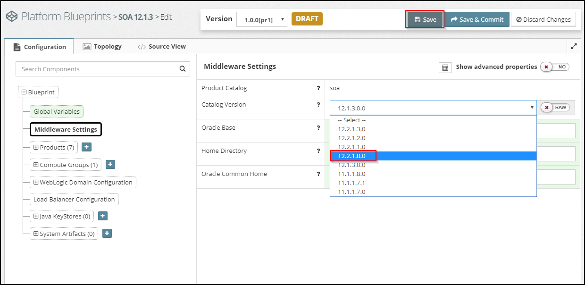
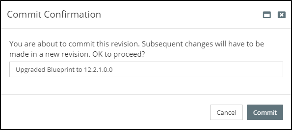

## {{ page.title }}

Please be aware when this is performed, existing application state will be lost. Do not use this approach for an application architecture with long running processes. In this case, it is advisable to perform an [In-place (State-preserving) Upgrade](/platform/upgrade/direct/inplace/README.md).

### Direct Upgrades made Simple

Before performing a fresh direct upgrade, Myst will need to have existing Platform Blueprint and one or more Platform Models based off that.

If a Platform Blueprint and Models for your existing environments does not exist, we can [introspect them using Myst](/platform/introspection/README.md).

When performing a fresh direct upgrade for a platform instance, terminate the instance, update the version number within the Platform Blueprint then re-provision the instance.

The end-to-end process consists of two simple steps and can be performed in minutes.

For the purpose of this guide, we are going to upgrade an existing Oracle Service Bus 12.1.3 environment to 12.2.1 using a fresh direct upgrade approach.


Although this example is for a 12.1.3 to 12.2.1 upgrade, the approach would be consistent for alternative version upgrades such as an upgrade of 11.1.1.7.0 to 12.1.3.0.0 or from 12.2.1.0.0 to 12.2.1.1.0.


#### Step 1 - Upgrade 12.1.3.0.0 Platform Blueprint to 12.2.1.0.0

##### Specify Oracle Middleware Upgrade Version

From the [Blueprint Editor](/platform/definitions/editor/README.md) click `Edit Configuration`. Then, navigate to the `Middleware Settings` in the tree.

Choose the version, `12.2.1.0.0` from the drop-down, the click `Save` to save the Blueprint.

##### View/Edit Platform Blueprint

Myst will automatically convert the 12.1.3 Platform Blueprint to an equivalent 12.2.1 Platform Blueprint, whilst preserving the custom configuration that were previously applied to that environment. This includes configurations such as JDBC Data Sources, File Stores, JMS Servers, JMS Modules, JCA Adapters and SAF Agents.

If we look closely at our Platform Blueprint, we can see that there are some subtle differences. For example, if we are using the default Fusion Middleware Home Directory of `/u01/app/oracle/product/fmw1213` we will see that it has changed to `/u01/app/oracle/product/fmw1221`.


If a custom `Home Directory` under `Middleware Settings` is being used, this must be changed so that it is unique before performing an upgrade. For example, if it is set to `/opt/my-company/12.1.3.0.0/soa`, it should be changed to `/opt/my-company/12.2.1.0.0/soa`.

Remember, a reference to the version `${[rxr.wls.Fmw-1].version}` may be used e.g. `/opt/my-company/${[rxr.wls.Fmw-1].version}/soa`. If this property reference is already being used, then it would have changed the path automatically. Once the property reference is set within the `Home Directory`, it will update automatically for future upgrades.

Make sure that any other property references to the version in the configuration which are hardcoded are using a reference, whilst it may not cause the upgrade to fail it will be a source of confusion for the upgraded platform.


Once the upgraded Platform Blueprint has been reviewed, click on `Save & Commit`. When prompted, enter a description for the change.

With these minor edits, we are now ready to upgrade our environments. Typically when upgrading, we will want to create multiple non-production environments, such as DEV, SIT, UAT and PRE-PROD to test and validate that the migrated code is performing as expected before promoting into Production. With Myst, we can use the same Platform Blueprint to upgrade all these environments, ensuring each environment is consistent with Production.

#### Step 2 - Terminate and Re-provision the existing environment

From the `Actions` menu for any Platform Instance, there is the option to `Terminate`. This will destroy the WebLogic Domain on the file system to allow for it to be upgraded. This approach is described in more detail in the section on [Managing Platform Instances](/platform/management/README.md).


Please be aware when this is performed, existing application state will be lost. Do not use this approach for an application architecture with long running processes. In this case, it is advisable to perform an [In-place (State-preserving) Upgrade](/platform/upgrade/direct/inplace/README.md).


When ready to do a fresh direct upgrade to an instance associated with the upgraded Platform Blueprint, simply trigger the `Terminate` then perform a `Reprovision`.
