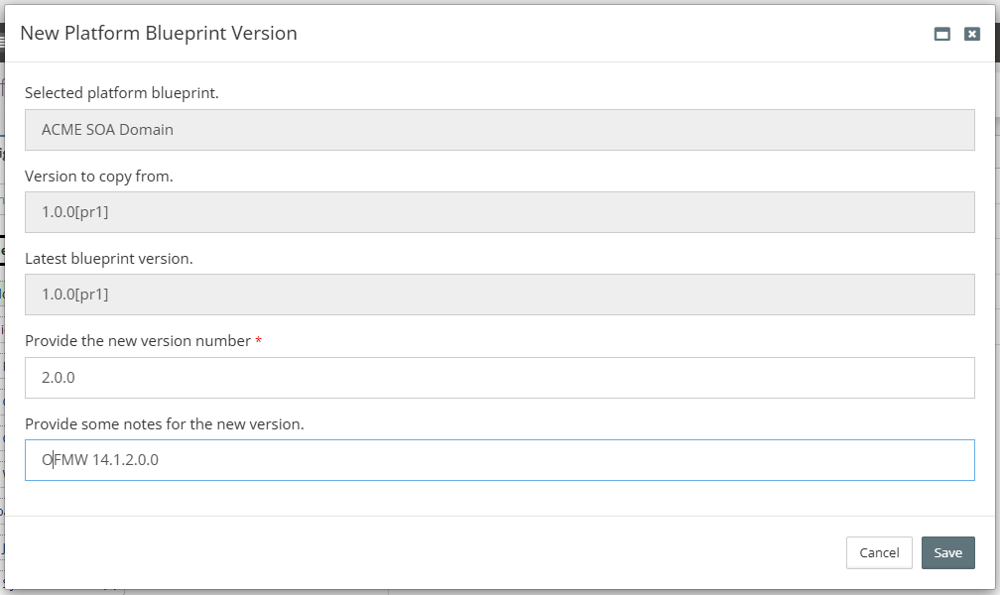
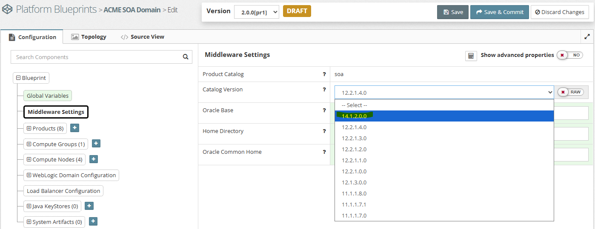
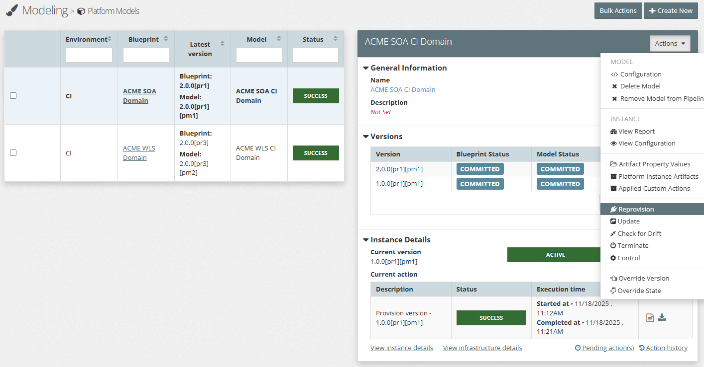
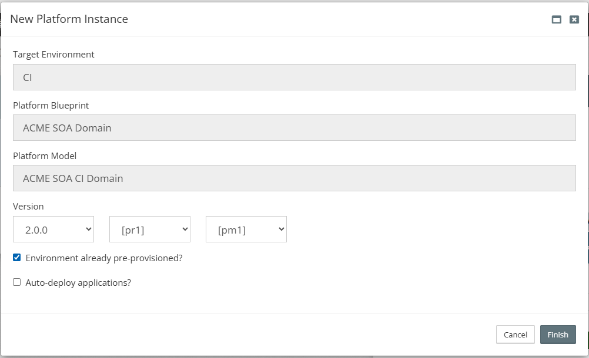
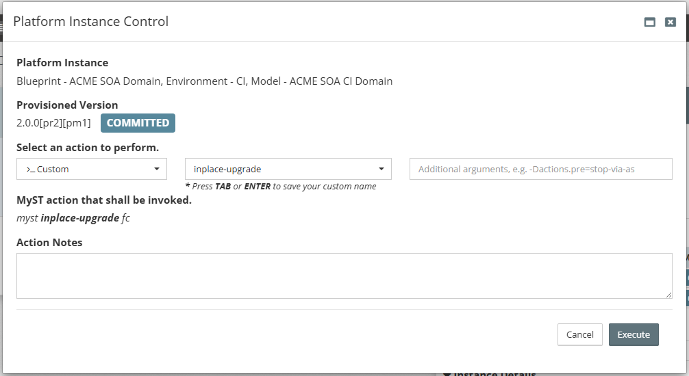

## {{ page.title }}

An Inplace Upgrade, from a high level, involves usually the following high level steps:

1. **Preparation**
	* Ensure you have adequate back ups of everything (Database, Oracle FMW hosts)
	* Supported versions of O/S, Database, and Java
	* Understand how you will validate the upgraded environment as well as testingany applications/processes that you run. This can also cause potentially interoperability and compatiblitiy issues.
	* How to manage downtime and/or integrations with other systems
1. **Install** FMW and other product distributions for your set up
1. **Stop** the domain
1. Run the **Repository Creation Utility** (RCU) to upgrade the database schemas
1. **Reconfigure** the domain
1. Run the **Repository Creation Utility** (RCU) to upgrade the domain components and configuration
1. **Restart** the domain and check everything is successful

Rather that replicate the information here, below are a couple of documentation references from Oracle that explain the process in more detail, and give considerations to planning activities, execution, and troubleshooting.

* [Upgrading Oracle WebLogic Server to 12.2.1.4.0](https://docs.oracle.com/en/middleware/fusion-middleware/12.2.1.4/wlupg/index.html)
* [Planning an Upgrade of Oracle Fusion Middleware to 14c](https://docs.oracle.com/en/middleware/fusion-middleware/14.1.2/asmas/index.html)

## How does Myst help

Myst has automated the inplace upgrade process into a callable action that helps to orcestrate the whole flow. In order to use the action (in step 4 below) there are some pre-requistes that need to be completed. The  process is as follows:

### Step 1: Ensure the dependencies for O/S version, Database version, and Java have been met.

Potentially upgrade the Operating System, ensure the:
* Oracle database is on version 19c+, and
* Java is on 17+.

There is more information in Oracle's certification matrix on the combinations that are supported.

### Step 2: Create a new version in the Platform Blueprint (for inheritence) and the associated Platform Model for the new Oracle Fusion Middleware catalog version.

Some key changes to make are:
* The `WLSSchemaDataSource` username should be updated to `<prefix>_WLS` and applied to the Platform Instance
* Add a Global Variable `remote.install` with the value `true` if it is not already present
* If you want Myst to perform any folder based back ups, include the following properties as Global Variables:
	* `backup.directory`: This is the directory where you want Myst to back up either the domain or product installation files
	* `backup.directory.skip`: Set this to `true` if you want to skip backing up
	* `remote.install.sharedDisk`: Set this to `true` if the product is installed on shared disk. This will impact how we tidy up the existing product installation if the product homes are the same between Oracle Fusion Middleware versions.

Here is an example of creating the Platform Blueprint with a version `2.0.0` and selecting the `14.1.2.0.0` catalog

Then create the associated Platform Model for domains that you would like to prepare for the upgrade. This can always be completed at a later date and it separates the preparation from the actual execution of the upgrade.

### Step 3: Perform a Re-provision with environment already pre-provisioned action

We want to update the version of our Platform Instance to the new version with the upgraded Oracle Fusion Middleware. Since we haven't installed the product, nor want to make any changes to the running domain yet, we perform this as a Re-provision and selecting the environment is already pre-provisioned. 

Select `Actions`, then `Re-provision`

Check the `Environment is already pre-provisioned`, then `Execute`

This will check we have the right version of Java and the domain exists in the location stored in the configuration.

### Step 4: Call the `inplace-upgrade` action

Now we can start the inplace upgrade. Go to `Actions`, select `Custom`, then type in `inplace-upgrade` and press `Enter`. Select `Execute` when you are ready to go.

Myst has its own pre-requistes checks it performs during the process such as:
* if `remote.install` is set
* if the `WLSSchemaDataSource` username should be updated to `<prefix>_WLS`
* running the Repository Creation Utility in readiness mode

#### Customising the Repository Creation Utility

If the provided response files for running the Repository Creation Utility upgrade assistant do not work for your configuration, you can create your own and refer to them during the upgrade process. To do that:

* Create text files in the `Custom Actions` for the response files: schema and components
* In the configuration, set the following Global Variables to refer to your custom response files:
	* `inplace.response.schema` with a value of something like `${myst.workspace}/path/to/file.rsp`
	* `inplace.response.component` with a value of something like `${myst.workspace}/path/to/otherfile.rsp`

### Step 5: Perform validations

Use the Weblogic Console in 12c or Weblogic Remote Console in 14c to validate that all the Weblogic Server resources are present. You can see the database schema status in the inplace upgrade log file when we display the schema version registry.