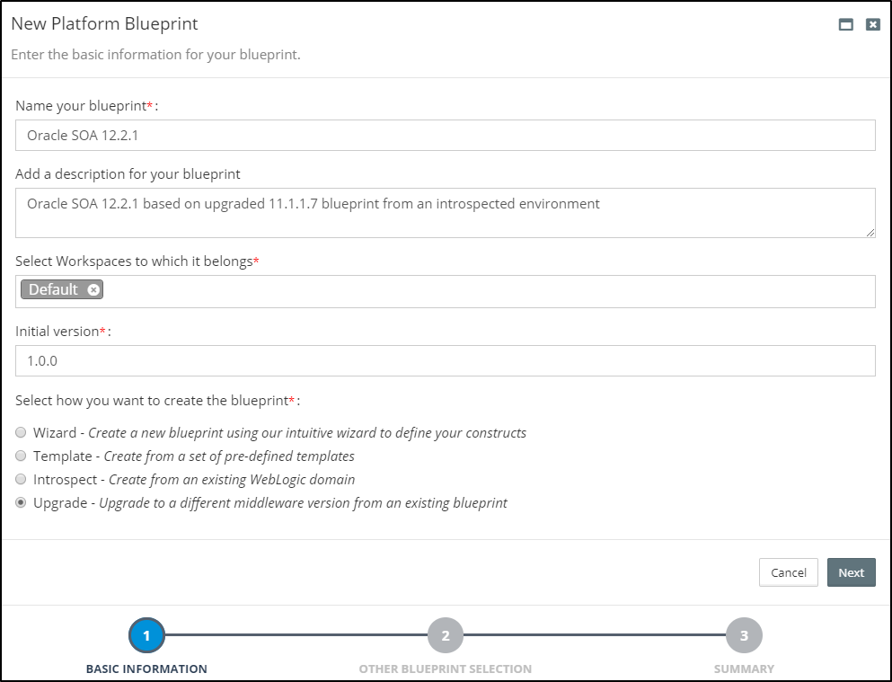
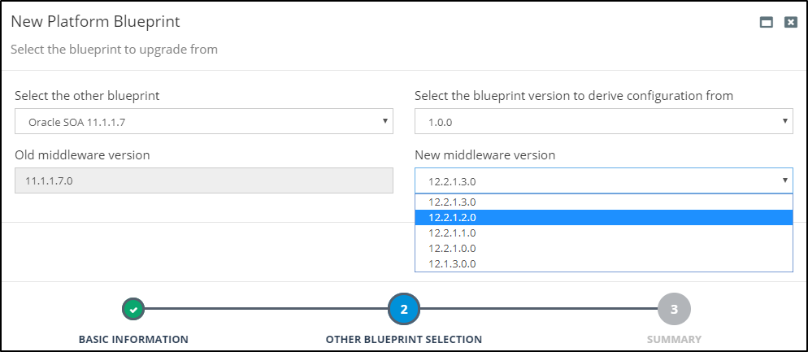
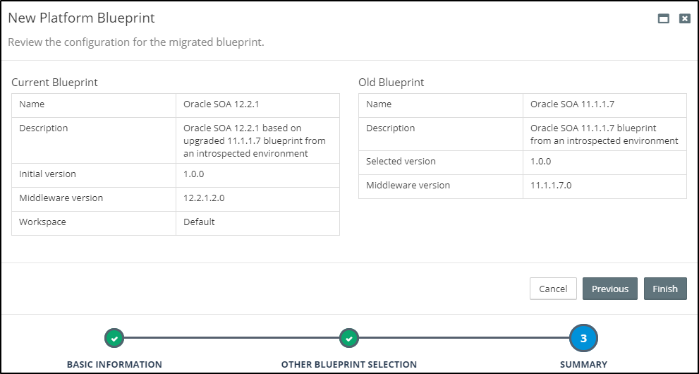
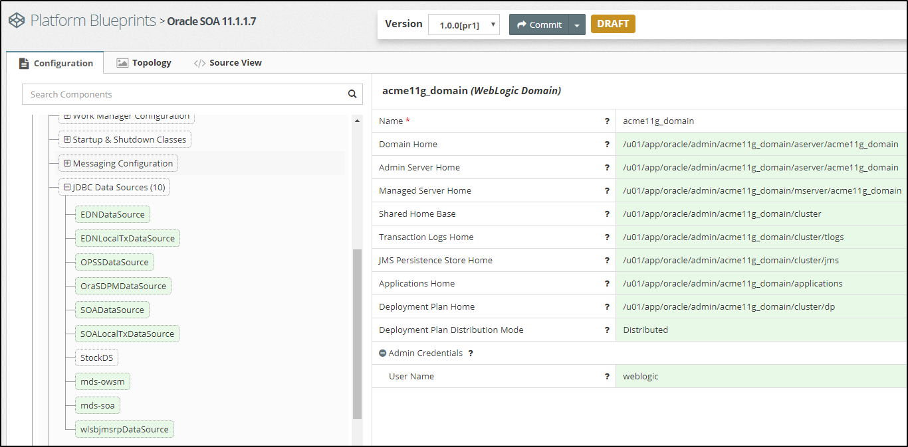
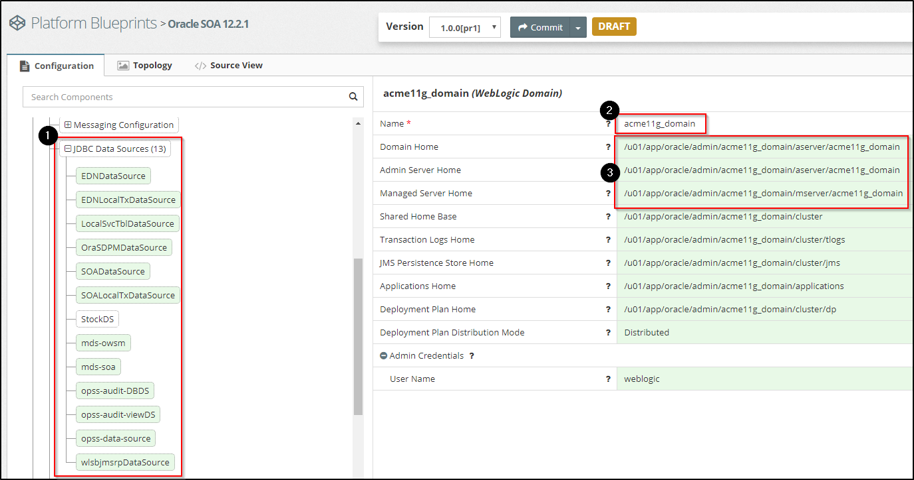
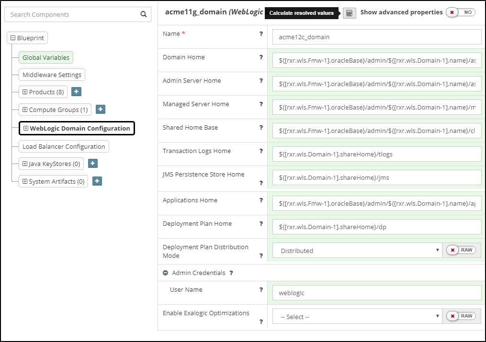
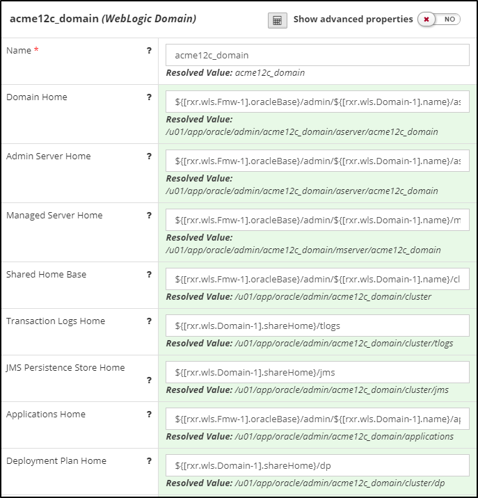

## {{ page.title }}

Most organizations, when migrating to Oracle SOA 12c or Oracle BPM 12c, choose to perform a side-by-side upgrade as it:

* requires zero downtime
* supports all SOA and BPM components
* allows for a phased migration
* involves significantly less risk

This involves provisioning a new instance of SOA/BPM 12c, replicating the configurations from your 11g platform and migrating and deploying your code. Once ready, you then switch over from 11g to 12c.

Most organizations fail to maintain accurate documentation of their current 11g configurations, so have to manually reverse-engineer their existing 11g production configurations so they can be re-applied to their new 12c environments. This is both time consuming and error prone approach.

Myst provides a simple and automated process for side-by-side upgrades. It allows administrators to introspect an existing 11g environment, extract the key configuration information and then use this to automatically provision an equivalent 12c environment in minutes.

### Side-By-Side Upgrades made Simple
When performing a side-by-side upgrade, Myst will introspect the existing environment and create a corresponding 11g Platform Blueprint.

Next, specify the Oracle Middleware version required. Myst will automatically convert the Platform Blueprint to one that is compliant with the Oracle Enterprise Deployment Guide, whilst preserving any custom configuration.

Finally, specify the target environment(s) for the new upgraded domain. Then at the click of a button, Myst will automatically provision an equivalent upgraded Oracle Middleware platform.

The end-to-end process consists of three simple steps and can be performed in minutes as shown below.


Although this example is for an 11g to 12c upgrade, the approach would be consistent for alternative version upgrades such as an upgrade from 12.1.3.0.0 to 12.2.1.2.0 or from 12.2.1.0.0 to 12.2.1.3.0.


#### Step 1 - Introspect SOA / BPM 11gR1 Domain
For the purpose of this guide, we are going to introspect an existing Oracle SOA 11.1.1.7 environment running on two VMs, that consists of a 2 node SOA Cluster and 2 node OSB Cluster.

The steps for introspecting an existing Oracle SOA or BPM environment are documented in the chapter - [Creating a Platform Blueprint from an Existing WebLogic Domain](/platform/introspection/README.md).


Introspection is only required if the environment to be upgraded was provisioned outside of Myst (e.g. by manual installation or another alternative method). If environment was built with Myst, the existing Platform Blueprint can be upgraded(as shown in the next step) rather than introspecting the environment first and creating one.


#### Step 2 - Upgrade 11g Platform Blueprint to 12c
The next step is to upgrade the 11g SOA Platform Blueprint to create a new SOA 12c Platform Blueprint. From the side menu navigate to `Modeling` > `Platform Blueprints`, this will display a list of existing Platform Blueprints. Click on `Create New` in the top right-hand corner of the screen. This will launch the `New Platform Blueprint` wizard.

In the initial dialog, we need to specify the following details about the Platform Blueprint:

* **Name** - Shorthand name for the Platform Blueprint.
* **Description** - A longer description of the Platform Blueprint.
* **Workspaces** - This defines the Workspaces to which the Platform Blueprint belongs (Role Based Access Control allows administrators to manage which workspaces a user has access to.)
* **Initial Version** - Specifies the initial version of the Platform Blueprint, we will stick with the default.

Finally, we need to specify how we want to create the Platform Blueprint, select the option to `Upgrade` from an existing blueprint and click `Next`.

##### Specify Oracle Middleware Upgrade Version

Next, we need to specify the Platform Blueprint that we want to upgrade, so from the drop down select the introspected Platform Blueprint; `Oracle SOA 11.1.1.7` in our example.

Next, we need to select the version of Oracle SOA 12c we want to upgrade to, in our example we will upgrade to `12.2.1.0.0`. Once done, click `Next`.

##### Review the Summary

Myst will display a screen showing the summary of the old Platform Blueprint that will be upgraded and the new Platform Blueprint that it will create in the process.

We can review these details. Once done, click `Finish`.

##### View/Edit Platform Blueprint

Myst will automatically convert our 11gR1 SOA Platform blueprint to an equivalent SOA 12c Platform Blueprint, whilst preserving the custom configurations that were previously applied to the 11g environment. This includes configurations such as JDBC Data Sources, File Stores, JMS Servers, JMS Modules, JCA Adapters and SAF Agents.

Once created, Myst will open the [Platform Blueprint Editor](/platform/definitions/editor/README.md) where additional configuration changes can be made; for example, we may want to add in the Enterprise Scheduler Service that wasn't included in 11gR1.

The first image above is that of the 11g Platform Blueprint while the second one below is that of the 12c one we created just now.

If we look closely at the 12c Platform Blueprint, we can see that the number of Data Sources is different. In the 11g Platform Blueprint, there were 10 JDBC Data Sources but in the 12c Platform Blueprint, there are 15 JDBC Data Sources (see box **1** outlined in red above). This is because in SOA 12c, changes were made to database schemas and corresponding JDBC Data Sources required by the Oracle SOA Platform.

When upgrading to 12c, Myst has the knowledge to remove the 11g data sources that are no longer needed and create the additional ones required for 12c. Myst has preserved the one custom data source, `StockDS` which is colored white (as opposed to product data sources in light green) in the screenshot above.

In addition, when the SOA 11gR1 domain was originally created, the middleware version number was specified as part of the Domain Name, for example `acme11g_domain`. The corresponding directory locations `Domain Home`, `Domain Aserver Home`, etc, also have this in their file path (see box **2** outlined in red above).

To change this, place the Platform Blueprint into `Edit` mode and update the WebLogic Domain name to `acme12c_domain`. Click on `Calculate resolved values` now.

We can see that Myst automatically shows the resolved values based on the new name.

With this minor edit, we are now ready to provision the new 12c environment. Typically when migrating to 12c, we will want to create multiple non-production environments, such as DEV, SIT, UAT and PRE-PROD to test and validate that the migrated code is performing as expected before promoting into Production.

With Myst, we can use the same Platform Blueprint to provision all these environments, ensuring each environment is consistent with Production. For each environment we want to provision, we need to create a Platform Model. This essentially maps the Platform Blueprint to the target infrastructure and captures environment specific configuration details, such as credentials.

#### Step 3 - Create Platform Model and Provision
Once we have finalized the migrated Platform Blueprint, the next step is to create a Platform Model and then use that to provision a Platform Instance. For more details on how to do this see [Chapter 3.2 - Creating a Platform Model](/platform/models/README.md).
